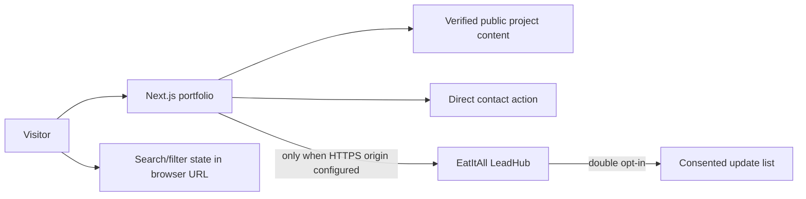
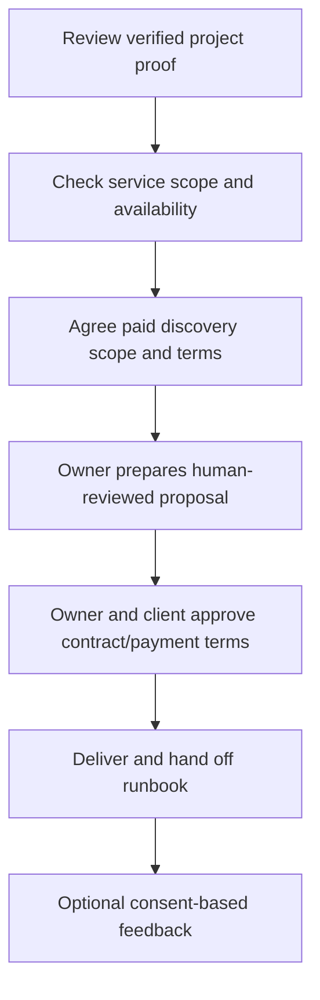

# Personal portfolio architecture

## Current system

The repository is a Next.js App Router site deployed on Vercel. Public project/work content is rendered from local source. A client-side search/filter shelf supports shareable URLs. An optional LeadHub form is rendered only when a valid HTTPS origin is configured; it submits an email address and consent metadata. There is no SaaS account, payment flow, or private client-data store.

## Data and trust boundary

- Public page content must be accurate, owner-reviewed, and limited to personal work; company repositories and confidential client data are out of scope.
- Search text and category filters remain in the URL/browser; they are not sent to an analytics provider by this feature.
- LeadHub receives only the signup email, consent, source host, and project key. The form stays hidden unless a verified HTTPS origin is set.
- Do not collect a client's project brief through the mailing-list form. Use an owner-controlled contact channel for project enquiries.
- Vercel HTTP 200 proves reachability only. It does not verify form delivery, lead consent, legal terms, or paid conversion.

## Proposed client workflow

This is a proposed service workflow, not automation currently implemented. Keep proposals, contracts, payment, scheduling, and client communications owner-reviewed. Do not promise unattended client acquisition or guaranteed income.

## Decisions still needed

- Verify current résumé, role dates, public projects, and allowed claims.
- Confirm service focus, available capacity, contact inbox, proposal/contract terms, payment/tax/refund handling, and support window.
- Confirm LeadHub URL, sender, privacy notice, and unsubscribe/suppression behavior before enabling capture.
